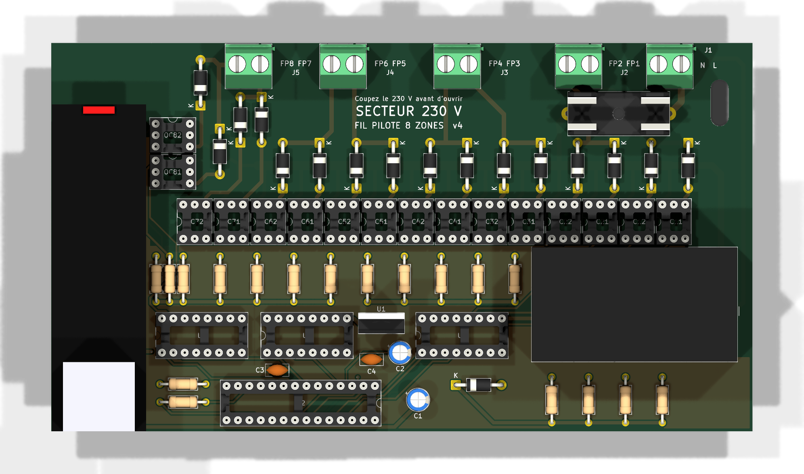

# Contrôleur fil pilote 8 zones — eedomus / ESP32-S3

Carte pour rail DIN qui commande huit zones de chauffage par fil pilote. Contrôleur Waveshare ESP32-S3-ETH-M en Ethernet, sans PoE. Firmware ESPHome et liaison eedomus prévus.

> **Danger : 230 V.** La carte n'a encore été ni fabriquée ni essayée. Aucune conformité n'est établie. Elle doit être relue par une personne qualifiée avant tout raccordement au secteur.

## La carte v4

**[Schéma, vues, contrôles et fichiers de la carte v4](hardware/kicad_v4/README.md)**

| Étape | État au 24/11/2026 |
|---|---|
| Schéma et PCB | Terminés, DRC et ERC à 0 |
| Gerbers | Prêts, dans [`hardware/kicad_v4/fabrication`](hardware/kicad_v4/fabrication) |
| Essai des pièces sur l'impression 1:1 | À faire |
| Distance entre lames des supports d'optos | À mesurer |
| Fabrication et essais | À faire |
| Firmware | Pas encore dans le dépôt |

Une seule phase pilote alimente les huit sorties, choix propre à l'installation visée. À vérifier pour toute autre installation, en particulier en triphasé.

## Documents à jour

- [Empreintes et brochages](docs/13_Empreintes-etape1.md)
- [Routage et distances](docs/14_Routage-etape4.md)
- [Contrôle final](docs/15_Controle-etape5.md)
- [Liste d'achat RS](docs/Liste_RS_Particuliers.csv) et [autres achats](docs/Liste_Farnell_et_autres.csv)

## Historique

- [`docs/`](docs/README.md), documents 01 à 12 : études précédentes, dépassées sur plusieurs points (pièces, commande des optos, PoE). En cas d'écart, les documents ci-dessus font foi.
- [`hardware/kicad`](hardware/kicad) : ancienne carte, **à ne pas fabriquer** (distances secteur non respectées).
- `SCH_...json`, `Schematic_...pdf`, `contour du projet.docx`, `Analyse et commentaires.md` : sources de départ.
