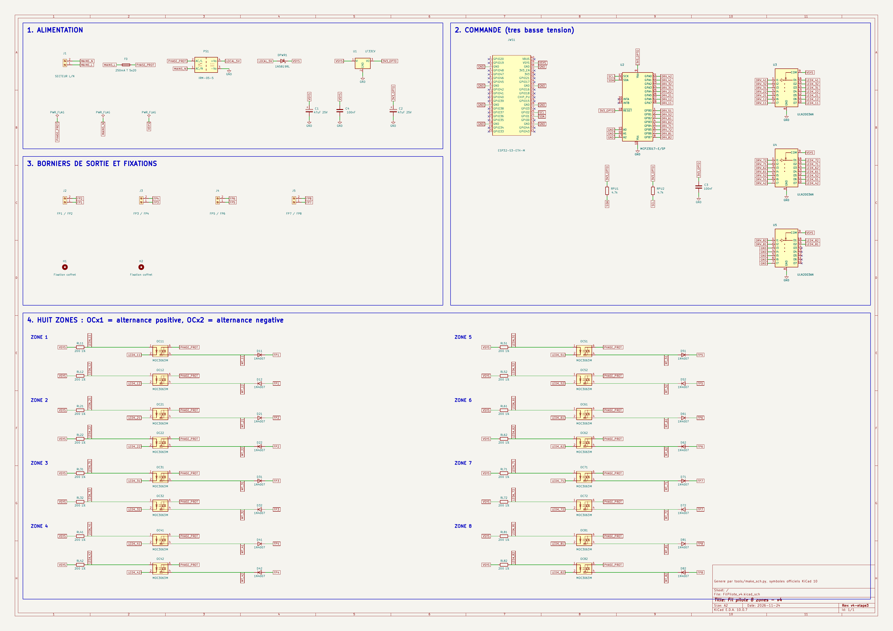
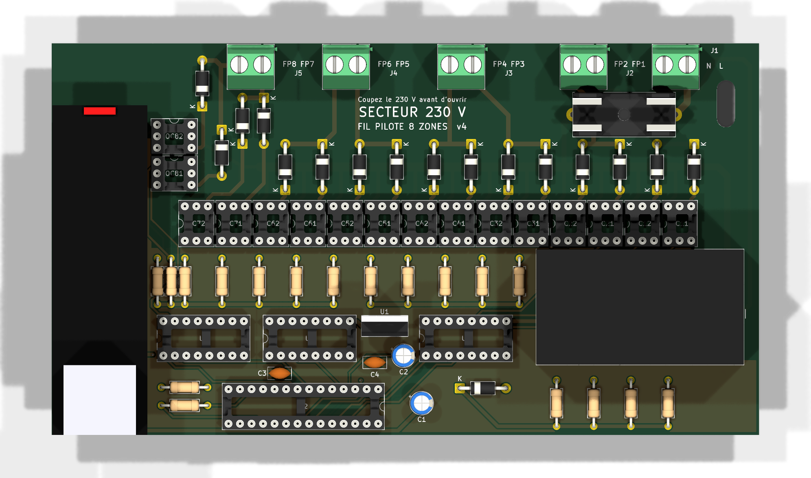
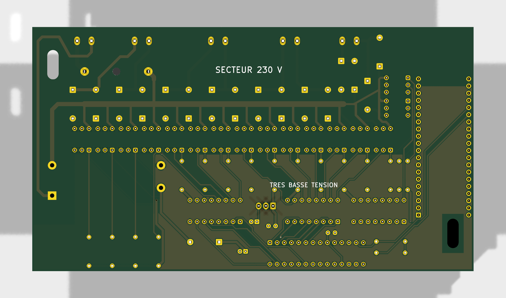
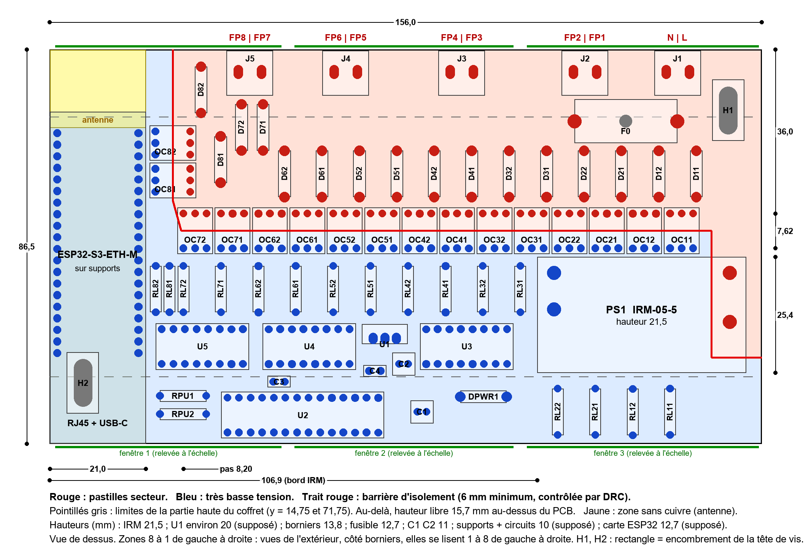
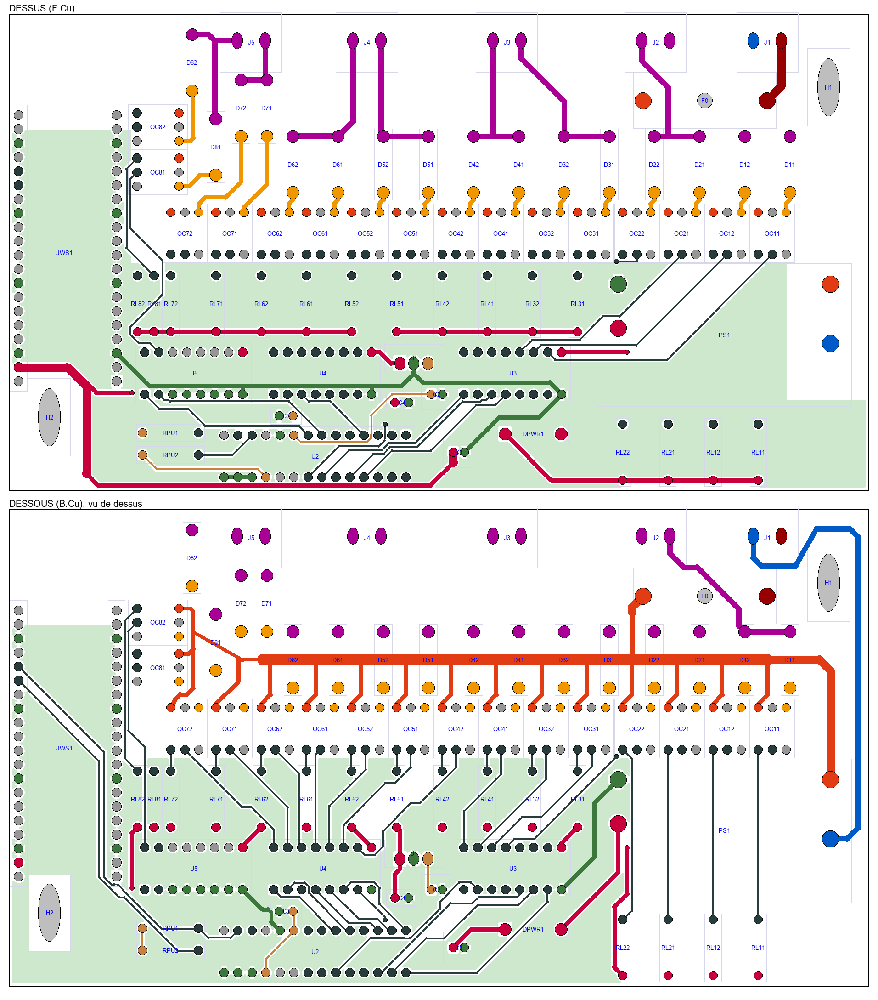
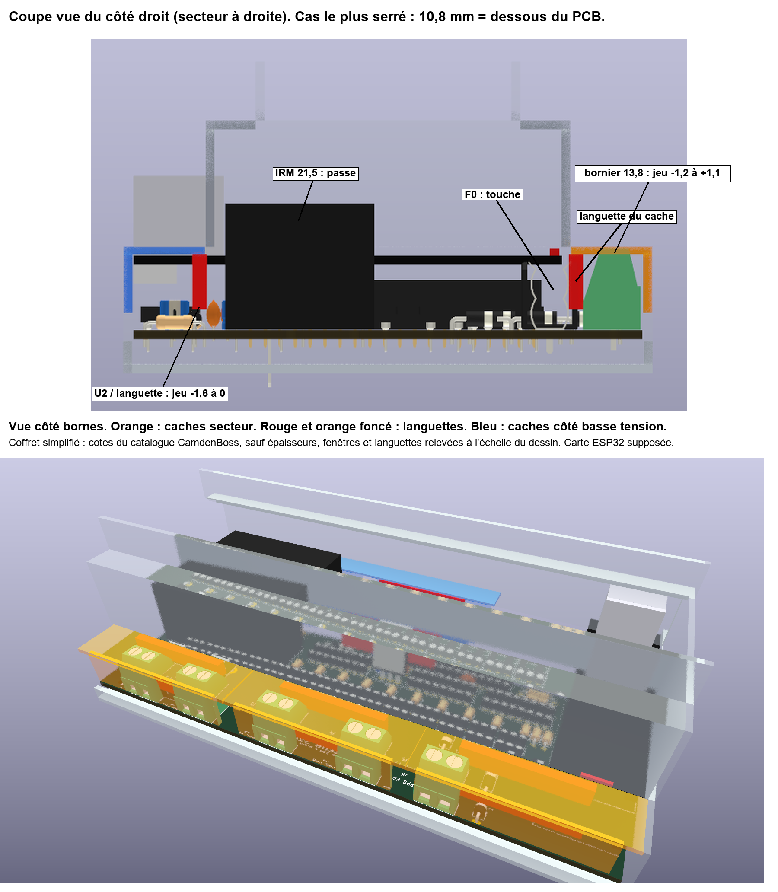

# Fil pilote 8 zones — carte v4

Carte KiCad 10 qui commande huit radiateurs par fil pilote depuis un ESP32-S3 en Ethernet.

> **Danger : 230 V.** Cette carte n'a encore été ni fabriquée ni essayée. Elle doit être relue par une personne qualifiée avant tout raccordement au secteur. L'ancienne carte, dans [`hardware/kicad`](../kicad), ne doit pas être fabriquée.

## Caractéristiques

- 156,0 x 86,5 mm, 2 couches, FR4 1,6 mm, pour coffret rail DIN CamdenBoss CNMB/9.
- Contrôleur Waveshare ESP32-S3-ETH-M (sans PoE), enfiché sur deux barrettes.
- Par zone : deux optotriacs MOC3063M et deux diodes 1N4007, un pour chaque alternance.
- Alimentation isolée Mean Well IRM-05-5, fusible 250 mA T à l'entrée.
- Composants traversants uniquement. Circuits intégrés, optos et ESP32 sur supports.

## Schéma

## Vues

Dessus :

Dessous :

Placement coté :

Cuivre, deux faces :

Dans le coffret (modèle simplifié, en partie relevé à l'échelle) :

## Contrôles

| Contrôle | Résultat |
|---|---|
| DRC, règle secteur / très basse tension de 6 mm active | 0 erreur, 0 avertissement |
| Connexions manquantes, écarts avec le schéma, ERC | 0 |
| Distance secteur / très basse tension, recalculée sans le DRC | 6,02 mm minimum (nominal) |
| Pastilles comparées aux fiches techniques | 309 sur 309 conformes |
| Gerbers relus sans KiCad | 6,02 mm minimum, 313 trous métallisés sur 313 |

Pas encore vérifié : distance entre les lames des supports d'optos (leur fiche annonce 1000 V RMS), essai des vraies pièces sur l'impression 1:1, position des fenêtres du coffret.

## Fichiers

| Fichier | Contenu |
|---|---|
| [`FilPilote_v4.kicad_pro`](FilPilote_v4.kicad_pro) | Projet KiCad 10 |
| [`FilPilote_v4.kicad_dru`](FilPilote_v4.kicad_dru) | Règles d'isolement |
| [`etape5_impression_1-1.pdf`](etape5_impression_1-1.pdf) | Impression à l'échelle 1:1 |
| [`fabrication/`](fabrication) | Gerbers, perçages, consignes |
| [`tools/`](tools) | Scripts de construction et de contrôle |
| [`versions/`](versions) | Sauvegarde de chaque étape |

Détails : [empreintes](../../docs/13_Empreintes-etape1.md), [routage](../../docs/14_Routage-etape4.md), [contrôle final](../../docs/15_Controle-etape5.md). Pièces : [liste RS](../../docs/Liste_RS_Particuliers.csv), [autres](../../docs/Liste_Farnell_et_autres.csv).
